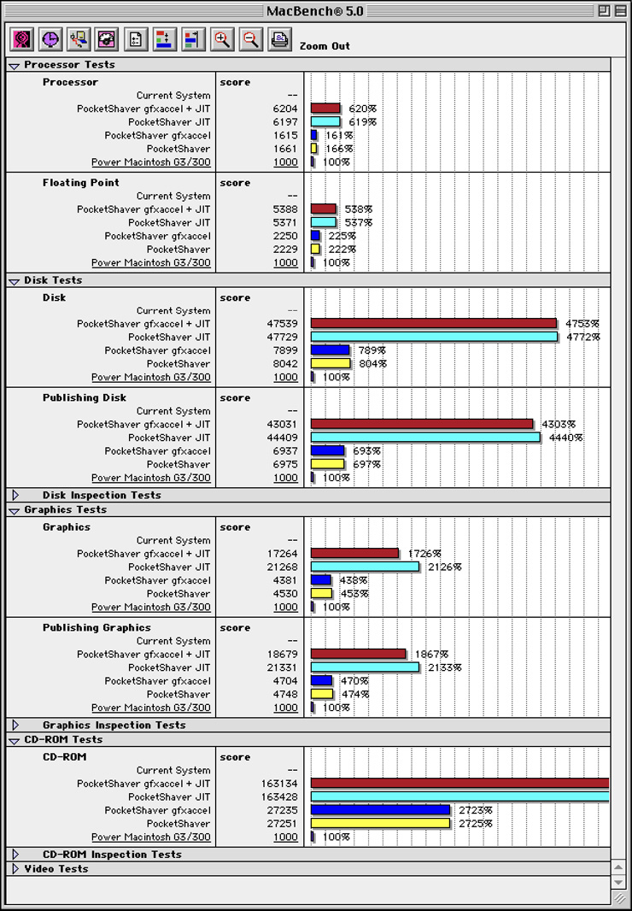

# PocketShaver

A fork of [SheepShaver](https://github.com/kanjitalk755/macemu) that brings Mac OS 8.6 - 9.0.4 emulation to iOS, iPadOS and macOS with Metal GPU acceleration, a UI built in Swift, LAN networking, and full touchscreen gamepad support.

PocketShaver extends the SheepShaver PowerPC emulation core with four Metal-accelerated graphics engines, a customizable on-screen gamepad, Bonjour peer-to-peer networking, a modern preferences system that adapts to the running platform, and (on Mac Catalyst) a PowerPC-to-arm64 JIT compiler. The upstream BasiliskII (68k) and desktop SheepShaver targets are preserved alongside the iOS-specific additions.

## Features

### Metal GPU Acceleration

PocketShaver implements four graphics acceleration engines, all targeting Metal:

- **QuickDraw 2D (NQD)** -- Metal compute acceleration for supported blits, solid fills, inversions, and masked operations, with CPU fast paths for small operations. Emulated RAM is wrapped as a shared `MTLBuffer`. Hooks decline operations whose clipping, layout, or transfer mode requires software QuickDraw.
- **QuickDraw 3D RAVE (Rendering Acceleration Virtual Engine)** -- RAVE 1.6 entry points supporting Gouraud shading, texture mapping, fog, alpha testing, multi-texturing, mipmaps, blending, and z-sorted transparency. Offscreen draw contexts and ATI VQ codebooks are unavailable. RAVE frames are composited over the 2D framebuffer through the shared Metal compositor.
- **OpenGL fixed function** -- Reports GL 1.1 with selected extensions, including two-unit multitexture, transpose matrices, and secondary colors. Implements matrix stacks, eight-light lighting, fog, texture environments, AGL drawables, and selected GLU/GLUT geometry helpers. Some GL 1.2-era entry points are present without advertising their complete extension: for example, 2D DXT uploads are decoded, while the full compression API and imaging subset are unavailable. GLUT window creation, its event loop, and callback-driven applications are unsupported. This is a compatibility implementation, not a conformance certification.
- **DrawSprocket** -- Full-screen display services including display-mode selection, back-buffer swaps, palette and gamma fades, and VBL-synced presentation through the Metal compositor. Swaps publish buffer contents; hardware page flipping is unavailable.

A unified **Metal compositor** handles 2D/3D compositing, supporting all Mac OS video depths (1/2/4/8/16/32-bit), palette updates for indexed color modes, and VBL-synced frame pacing.

### JIT Compiler (Mac Catalyst)

A from-scratch PowerPC-to-arm64 dynamic recompiler, built as a native Apple Silicon backend for the existing Kheperix JIT framework:

- Threaded-code code generation with direct block chaining between compiled blocks
- Native arm64 translation of the integer ALU/logical/shift/rotate/multiply/divide/compare/condition-register ops, branches, integer and floating-point loads/stores, and FP arithmetic, with an inline fastmem path for guest memory access
- W^X code generation (`pthread_jit_write_with_callback_np`) for Apple Silicon's hardened runtime
- A default-deny mnemonic whitelist: only instructions with a validated, lockstep-tested native implementation compile natively -- everything else (AltiVec/vector ops included) falls back to the existing generic interpreter, so correctness never trades against coverage
- Toggle under **Advanced** preferences ("JIT compiler", restart required); on by default

JIT is only available on the Mac Catalyst build. Apple's JIT entitlements aren't available to iOS apps (including "Designed for iPad" on macOS), so those targets remain interpreter-only.

### On-Screen Gamepad (iOS / iPadOS)

A fully customizable virtual gamepad overlay for touchscreen play:

- Per-button assignment to keyboard keys, mouse clicks, or joystick types (mouse, WASD, arrows, 8-way)
- Configurable button grid layout
- Ordinary Classic Mac OS keyboard keys as well as special keys (Cmd-W, left click, right click, toggle audio etc.)
- Multiple saved configurations
- In-game editing mode for remapping buttons without leaving the emulator
- Example layouts included (arcade, FPS, RPG)

### Two-finger steering (iOS / iPadOS)

A new optional way of steering the mouse cursor on touchscreen that makes fast and accurate mouse control possible:

- **Accuracy** -- allows precise placement of cursor by not obscuring the cursor by your thumbs
- **Speed** -- allows quick placement of the cursor and mouse clicking at any place of the screen, by minimal thumb movement
- **Long drag** -- allows long mouse drag movements, for long click-and-drag actions or rectangular selection of a large area (as needed in real time strategy games)

### Touch Input (iOS / iPadOS)
- **Relative mouse mode** -- needed for certain game and software titles
- **Right-click** -- available as gamepad overlay key on touchscreen, as well as hardware support for physical mouse / mousepad
- **Soft keyboard** -- iOS keyboard bridged to emulated Mac input with configurable screen offset (top, middle, bottom)
- **Haptic feedback** -- independent toggles for gestures, mouse clicks, and key presses

### Bonjour LAN Networking

Peer-to-peer networking between devices over local network, using Bonjour:

- **Host mode** -- provides router functionality, shows connected clients
- **Client mode** -- discovers hosts via Bonjour, auto-join with persistent device tracking
- Device naming and renaming within the LAN
- Automatic reconnection after app suspension
- Networking between platforms also possible (iPhone to Mac etc.)
- Alternative Slirp networking also available

### Preferences

A tabbed preferences interface with five sections:

| Tab | Contents |
|---|---|
| **General** | Setup, disk management (create/import/delete), audio toggle, input options, haptic feedback, hints |
| **Graphics** | Monitor resolutions, rendering filter (nearest/bilinear), frame rate (60/75/120 Hz), gamma ramp, NQD/RAVE/GL acceleration toggles |
| **Network** | Slirp vs. Bonjour selection, host/client role, peer browsing, device naming |
| **Advanced** | RAM setting, performance metrics (FPS counter), UI options, relative mouse settings, bootstrap/ROM info, JIT compiler toggle (Mac Catalyst) |

The UI adapts to the platform -- on macOS, the Gamepad tab is hidden and touch-specific options are suppressed.

### Disk and ROM Management

- Create new virtual disks with configurable size
- Import external disk images
- Install and validate Mac OS ROM files with version detection
- Boot disk selection and CD boot support

### Performance Monitoring

- FPS counter overlay option
- Network transfer rate overlay option

## Benchmarks

<p align="center">
  
</p>

<p align="center"><em>MacBench 5.0 scores (higher is better), normalized to a Power Macintosh G3/300 at 100&#37;. On Mac Catalyst, the PowerPC-to-arm64 JIT lifts Processor and Floating-Point past 6&times; the G3/300, while the four Metal graphics engines drive the Graphics, Publishing, Disk, and CD-ROM results.</em></p>

## Platform Support

| Platform | Status |
|---|---|
| iOS (iPhone/iPad) | Primary target -- full touch, gamepad, and GPU acceleration |
| "Designed for iPad" on macOS | Supported -- gamepad hidden, keyboard/mouse passthrough |
| Mac Catalyst | Supported -- native Mac build with the PowerPC-to-arm64 JIT compiler |

## Building

PocketShaver is built as an Xcode project:

```
SheepShaver/src/MacOSX/PocketShaver.xcodeproj
```

Targets are included within the Xcode project for Mac Catalyst and iOS.

## Upstream

Forked from [kanjitalk755/macemu](https://github.com/kanjitalk755/macemu) (SheepShaver / BasiliskII).
